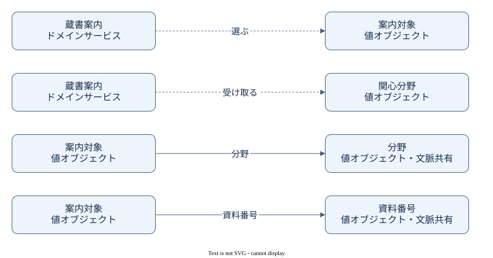

# 蔵書案内のドメインモデル

この業務は集約と状態遷移を持たず、資料を探すときの選択と順序を決める。

## 判断に使う値と結果

<!-- domain-model:elements -->

| 識別子 | 名前 | 種別 |
| --- | --- | --- |
| LibraryCatalog | 蔵書案内 | ドメインサービス |
| CatalogCandidate | 案内対象 | 値オブジェクト |
| BookNumber | 資料番号 | 値オブジェクト・文脈共有 |
| Subject | 分野 | 値オブジェクト・文脈共有 |
| Interest | 関心分野 | 値オブジェクト |

<!-- domain-model:relations -->

| 関係元 | 関係先 | 種類 | 関係 |
| --- | --- | --- | --- |
| LibraryCatalog | CatalogCandidate | 依存 | 選ぶ |
| LibraryCatalog | Interest | 依存 | 受け取る |
| CatalogCandidate | Subject | 参照 | 分野 |
| CatalogCandidate | BookNumber | 参照 | 資料番号 |

蔵書案内は案内対象と関心分野を受けて資料を探す。

## 選択と順序

関心分野と同じ分野の資料だけを選ぶ（BDD-001）。選んだ資料は資料番号の小さい順に並べる（BDD-002）。
