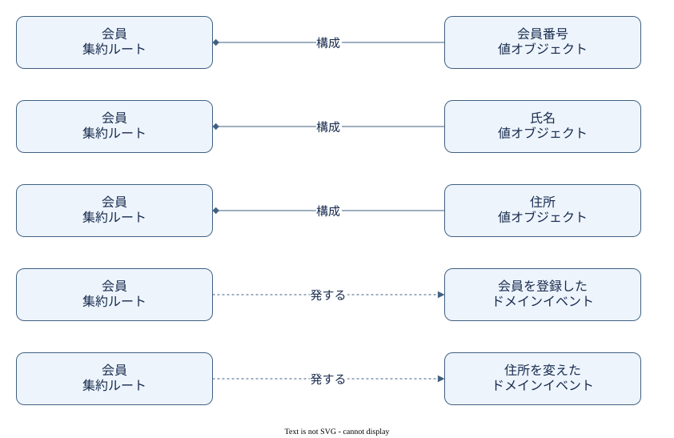

# 会員の住所録のドメインモデル

この文脈には、一つのコマンドで守る決まりがほとんど無い。会員は氏名と住所を持ち、住所の形が正しいことだけを確かめる。

## クラス図

<!-- domain-model:elements -->

| 識別子 | 名前 | 種別 |
| --- | --- | --- |
| Member | 会員 | 集約ルート |
| MemberNo | 会員番号 | 値オブジェクト |
| Name | 氏名 | 値オブジェクト |
| Address | 住所 | 値オブジェクト |
| Registered | 会員を登録した | ドメインイベント |
| Moved | 住所を変えた | ドメインイベント |

<!-- domain-model:relations -->

| 関係元 | 関係先 | 種類 | 関係 |
| --- | --- | --- | --- |
| Member | MemberNo | 構成 |  |
| Member | Name | 構成 |  |
| Member | Address | 構成 |  |
| Member | Registered | 依存 | 発する |
| Member | Moved | 依存 | 発する |

会員は会員番号、氏名、住所を受けて登録し、住所を変える。

## 未決

なし
